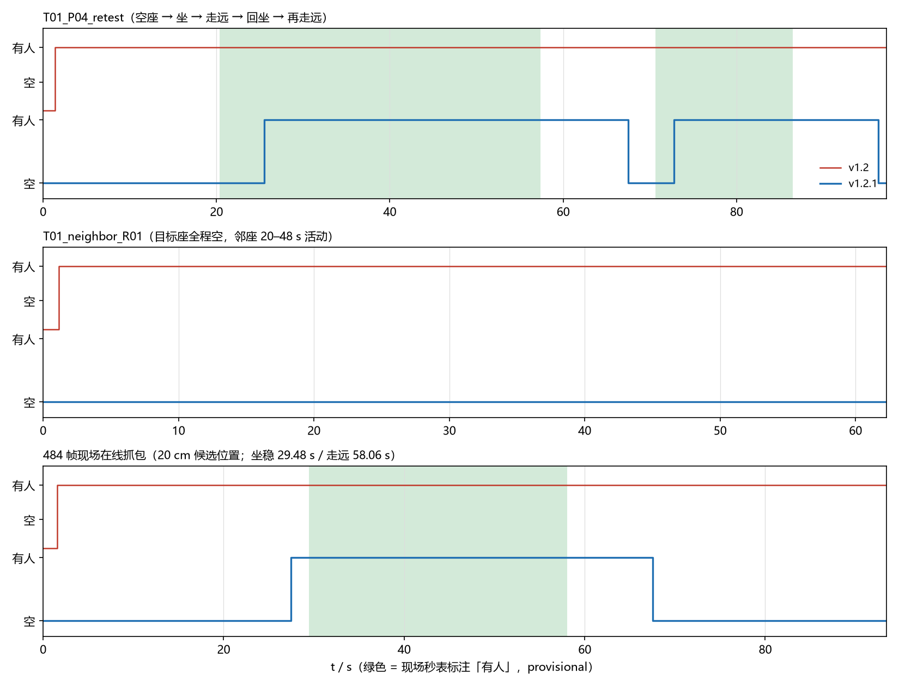

# C · M1 v1.2.1 修复交付报告（离座判空 / 开场空座 / 奇偶 chirp）

- 任务来源：组员 2026-11-21 任务单（「在独立分支做 v1.2.1，用同一组 484 帧实测证明
  『开场空座不误报、静坐保持有人、走远后能判空』」；第二轮追加「修复标定结束后
  第 11.61 秒的开场误判」）
- 分支：`feat/c-v1.2.1`（PR #9）；v1.2 配置与既有输出未改动
- 更新：2026-11-21（含 484 帧现场抓包复跑）
- 代码：`algos/m1_v121.py` + `config/M1_dev112p_v1.2.1.json`
  + `tools/dev112p_adapter.py --parity split`（转换层）
  + `detect.py` / `algos/online_detector.py` / `algos/m1_features.py`（接入）
  + `tools/eval_v121.py`（验收表）

## 0. 结论

| 验收项 | v1.2 | v1.2.1 |
|---|---|---|
| 开场空座误报（含 484 帧现场抓包，8 组有秒表标签） | 341/341 帧 = **100%** | 11/341 帧 = **3%**（全部在 484 的「坐稳前 2.0 s」） |
| 静坐保持（入场后） | 2013/2013 = 100%（**靠永不释放实现**） | 1895/1914 = **99%** |
| 邻座/过道全空组误报 | 532/532 = **100%** | 0/532 = **0%** |
| 走远判空 | 8 个离座事件 **0 次释放** | **4 次按预期释放（9.0–10.1 s）** |

**484 帧现场抓包（组员复核用）**：开场 11.61 s 误判已消除——判决改为在标定结束后
再等满一个 10 s 微动窗才启用（≈20.1 s），过渡段只进诊断量；v1.2.1 现在
**0→1 于 27.48 s（坐稳前 2.0 s，人到座）**、**1→0 于 67.53 s（走远后 9.5 s）**，
静坐段 142/142 帧保持有人，走远后至录制结束 0 误报。

## 1. v1.2 为什么失败（本轮复核）

1. **开场 1 帧锁背景**：`bg = X[0]`。tx_polling=1 时奇/偶 chirp 幅度相差 ~11×
   （T01 实测奇 ≈16200 / 偶 ≈1450 counts），frame 0 常是缺 chirp 的部分帧
   （27 奇 + 26 偶），简单均值给种子帧 **+139 counts** 偏置；配合上电快衰减，
   1–2 s 内 f1 饱和 → presence 钉死为 1（484 现场：1.548 s 翻 1，476/484 帧有人，
   全程零释放）。
2. **离座不判空**：占用态冻结背景后，设备慢漂移（−1.9~−6.2 %/min）让
   |X−bg| 只增不减，score 永不回落到 t_off → 9/9 离座零释放。
3. 单帧均值把奇/偶两条发射链路混在一起，部分帧的奇偶配比变化会直接改变背景
   幅度——这是转换层（`chirp_mean`）的问题，不是阈值能修的。

## 2. v1.2.1 的三点修复

### R1 奇偶 chirp 分开处理（转换层 + 特征层）

- `tools/dev112p_adapter.py --parity split`：按 chirp 序号奇/偶各自做 valid-chirp
  复均值，输出 `[frame, chirp_parity, range]`（parity 0 = 序号 0,2,4…），
  `axis_order = ["frame","chirp_parity","range_bin"]`。
- 算法对每条 parity 链**各自**估计背景/噪声底，再在比值域平均；部分帧缺 chirp
  只影响该 parity 自身均值，不再产生跨奇偶的配比偏置。
- 在线侧同一口径：`project_dev112p_frame(..., parity=True)` 与适配器
  `chirp_split` 逐字节一致；`SeatDetector` 自动识别 3 维 `raw_shape`。

### R2 开场空座标定（先积累 ~10 s 有效帧，再启用判断）

- 标定期只累积空座背景、估计噪声底，**不做占用判断**（presence 恒 0，开场不误报）；
- 完成条件：`ts ≥ 10 s` **且** 有效帧 ≥ 40（缺帧自动延长，不会用 1 帧锁背景）；
- 噪声底 = 标定窗内 Bin1 微动指数的 20 分位（P20），F1 参考 = 标定帧
  泄漏归一残差的中位数；
- 设备上电 6 s 内的瞬态样本不进微动窗（`warmup_guard_s`）；
- **整窗等待（2026-11-21 追加）**：标定结束后，慢窗必须完全落在标定结束之后
  （`t ≥ calib_end + 10 s`，即 ≈20.1 s）才允许判决。484 帧实测中 10.2–14.5 s 的
  慢窗仍混着 10–13 s 的幅度台阶/回摆，m=4.6–6.5，正是 11.61 s 误入场的来源；
  等待整窗后同一段 m 降到 3.5→1.1（低于入场阈值 4.0），误判消失。

### R3 F1 归一化重设计 + 以 Bin1 微动判空

**F1（背景差异）重新归一化**：

- 每个 bin 先除以 bin0（设备泄漏，与场景无关）→ 幅度比值 `q = |X|/|X0|`；
  再与标定空座幅度比 `q̄` 比较，得到相对残差 `f1_db = 10·log10(Σ|q−q̄|²/Σ|q̄|²)`。
  这消除了热状态/绝对基数（T01 各场 3538–10245 counts，2.9×）的尺度差异；
  v1.2 的绝对 `f1_db_map [30,43.5]` 在热机基数上放大 2–2.9 倍的问题不再存在。
- 本数据上**均值层不足以判人**——静坐者 Bin1 均值变化只有 −0.3%~−2.4%，与
  90 s 内 −9 dB 的残余漂移同量级。所以 F1 不单独触发，只在**判空时刻作否决**：
  要求最近 2–10 s 的 F1 残差变化 ≤ 6 dB（新空座证据必须稳定，不是过渡态）。

**判空条件（新）**：Bin1 瞬时变化量（10 s 窗、去线性趋势的幅度标准差 / 均值，
按标定空座噪声底归一，记 `m`）：

- 入场：`m ≥ 4.0` 连续 8 帧（≈1.5 s）；
- 保持：不满足判空条件即保持有人；
- **判空**：`m ≤ 1.45` 且 4 s 快窗 `m4 ≤ 2.2` 连续 **26 帧（≈5 s）**，
  且 F1 残差稳定（`|Δf1| ≤ 6 dB`）→ presence=0，并用最近 10 s 空座帧
  **重建背景快照与噪声底**（下一次入场以新的空座水平为基准）。
- 噪声底/F1 参考**只在无人态更新**（占用态冻结），否则静坐者的低微动会被
  当成新空座吸收（实测会把 P02 的 m 从 1.5 拉到 0.7 并在 120 s 误判空座）。

### 与组员三点要求的对应

| 要求 | 落地 |
|---|---|
| 1. 修开场校准；奇偶 chirp 分开处理；确认空座后先积累 ~10 s 有效帧再启用占用判断 | R1 + R2（标定 + 整窗等待） |
| 2. 修离座不判空；重新设计 F1 背景差异的归一化和判空条件，靠新的空座证据切回无人 | R3（泄漏归一 F1 + 微动判空 + 快照重建） |
| 3. Bin1 瞬时变化作为辅助证据，与其它证据一起用 | R3（Bin1 微动为主证据；F1 稳定性作否决；两者联合，不单用阈值） |

## 3. 验收对照表（同口径，v1.2 vs v1.2.1）

数据：`examples/real/`（v1.2 单链）、`examples/real_v121/`（v1.2.1 奇偶分链）、
`examples/live_v121/`（484 帧现场抓包，20 cm 候选位置），真值来自 B 归档
`meta.annotation.stopwatch_events`（现场秒表，provisional）。生成命令：

```powershell
python -X utf8 tools/eval_v121.py
```

| 组 | 录制 | 真值 | 开场误报 v1.2 | 开场误报 v1.2.1 | 静坐保持 v1.2 | 静坐保持 v1.2.1 | 走远判空 v1.2 | 走远判空 v1.2.1 |
|---|---|---|---|---|---|---|---|---|
| t01-p02-formal | T01_P02_R01 | 秒表 | 41/41 (100%) | **0/41 (0%)** | 631/631 | 613/613 (100%) | 未释放 1 | 未释放 1 |
| t01-p02-retest | T01_P02_retest | 秒表 | 48/48 (100%) | **0/48 (0%)** | 236/236 | 225/225 (100%) | 未释放 2 | 未释放 2 |
| t01-p04-formal | T01_P04_R01 | 秒表 | 37/37 (100%) | **0/37 (0%)** | 618/618 | 574/593 (97%) | 未释放 1 | 未释放 1 |
| t01-p04-retest | T01_P04_retest | 秒表 | 54/54 (100%) | **0/54 (0%)** | 261/261 | 225/225 (100%) | 未释放 2 | **10.1 / 9.9 s** |
| t01-chair-shift | T01_chair_shift | 秒表 | 60/60 (100%) | **0/60 (0%)** | 125/125 | 116/116 (100%) | 未释放 1 | **9.0 s** |
| live-484 | T01_http_live_…965862 | 秒表 | **101/101 (100%)** | **11/101 (11%)** | 142/142 | 142/142 (100%) | 未释放 1 | **9.5 s** |

邻座/过道全空组（目标座全程空）：

| 组 | v1.2 误报 | v1.2.1 误报 |
|---|---|---|
| t01-neighbor（邻座坐 20.28–47.8 s） | 271/271 (100%) | **0/271 (0%)** |
| t01-aisle（4 次过道经过） | 261/261 (100%) | **0/261 (0%)** |



上图：P04_retest（空座→坐→走远→回坐→再走远），v1.2 在 t≈1.2 s 翻成有人后
再也不回落，v1.2.1 跟随绿色真值区间；中图：neighbor（目标座全程空）v1.2 全程
误报、v1.2.1 全程为空；下图：484 帧现场抓包，v1.2 在 1.5 s 翻 1 后零释放，
v1.2.1 在 27.5 s（坐稳前 2 s）入场、67.5 s 判空。

## 4. 484 帧现场抓包复跑（组员 2026-11-21 复核）

输入：`T01_484_C_replay.zip` → `examples/live_v121/
T01_http_live_20261119_201257_965862_c1r0_1dfft_parity_raw.npz`
（484 帧、93.46 s、c1r0、奇偶分链；秒表：坐稳 29.48 s / 走远 58.06 s；
源归档 SHA-256 `f5ec3465…`，20 cm 候选安装位置）。

| 检查项 | v1.2 | v1.2.1（组员复跑，修复前） | v1.2.1（本交付，修复后） |
|---|---|---|---|
| 开场误判 | **1.548 s 翻 1**（空座段 101/101 帧有人） | **11.61 s 翻 1**（开场 18 帧有人） | **0 帧**直到 27.48 s（坐稳前 2.0 s 首次检出人到座） |
| 静坐保持 | 142/142 帧有人（但永不释放） | 112/112 帧 | **142/142 帧（100%）** |
| 走远判空 | **零释放**（168/168 帧仍有人） | 67.53 s 释放（走远后 9.47 s） | **67.53 s 释放（走远后 9.47 s）**，此后至结束 0 误报 |

11.61 s 误判的根因与修法（本轮新增）：标定结束（10.06 s）时 10 s 慢窗里仍含
10–13 s 的幅度台阶（bin1 −164 counts）与回摆（+70 counts/3 帧），m 在
10.2–14.5 s 为 4.6–6.5，满足「m≥4 连续 8 帧」；修法是**整窗等待**——慢窗必须
完全位于标定结束之后才允许判决（≈20.1 s）。等待后同一段 m 为 3.5→1.1，
低于入场阈值，误判消失；真实入座（25.5 s 起 m 4.6→17）不受影响。

复跑命令（仓库内已含 484 的奇偶分链输入）：

```powershell
python -X utf8 detect.py --recording examples/live_v121/T01_http_live_20261119_201257_965862_c1r0_1dfft_parity_raw.npz \
    --config config/M1_dev112p_v1.2.1.json --emit-scores --out <out>
python -X utf8 tools/eval_v121.py      # 表内含 live-484 一行
```

## 5. 已知限制（如实声明）

1. **完全静止 ≥12 s 可能误判空座**：T01_P04_R01 末段 114–126 s 受试者后靠
   不动，Bin1 微动落到 m≈1.0（与空座重叠），判空后静坐保持 97%。这是本硬件
   「静坐 vs 空座」在均值/方差层最小间隔只有 1.2–2.5× 所致（484 抓包里该比值
   是 6.7×，同一阈值余量充足）。
2. **走远段本身在波束内**时不会立即判空：P02（12.3 s 离座）与
   P02_retest（16.6 s 离座）的「走远」过程 m 一直高于 1.45，直到人走出波束后
   才可能满足判空条件，录制内未回到 0（表中「未释放」）。判空延迟 =
   人离开波束的时间 + 5 s 确认，不是固定 10 s。
3. 邻座/过道两组现在 0 误报，但这是在本轮配置（入场 4.0、确认 8 帧、整窗等待）
   下成立的；邻座组 Bin1 空座幅度只有 1305 counts（P04 为 5501），说明该场次
   目标座反射体偏弱、邻座实际坐在监控区内——门槛再低会重新引入误报。
4. 入场延迟 0.1–7.7 s（受试者静止程度决定），未做亚秒级优化；484 抓包为
   坐稳前 2.0 s（人到座）。
5. P01/P03/pilot/short 无实测标签，只做不评分回放；P01 的「有人」段是计划
   口令，不是真值。

## 6. 在线/离线一致性与复现

```powershell
# 离线单组
python -X utf8 detect.py --recording examples/real_v121/T01_P04_retest_c1r0_1dfft_parity_raw.npz \
    --config config/M1_dev112p_v1.2.1.json --emit-scores --out <out>

# 在线逐帧回放并与离线逐字节比对
python -X utf8 tools/live_seat.py --replay examples/real_v121/T01_P04_retest_c1r0_1dfft_parity_raw.npz \
    --config config/M1_dev112p_v1.2.1.json --out <live_out> --emit-scores --expect <out>
```

实测：`[PASS] T01_P04_retest_c1r0_1dfft_parity: online replay == offline (byte-identical)`
（result.csv 28,281 B、scores.csv 40,412 B 逐字节一致）。
484 抓包也可用 `tools/live_seat.py --replay examples/live_v121/…_parity_raw.npz` 逐帧回放。

## 7. 交付物索引

| 文件 | 内容 |
|---|---|
| `algos/m1_v121.py` | v1.2.1 状态机（奇偶分链/标定/整窗等待/微动判空/快照重建） |
| `config/M1_dev112p_v1.2.1.json` | 冻结配置（阈值、窗口、验收口径） |
| `tools/dev112p_adapter.py` | `--parity split` 转换；meta 带 annotation |
| `tools/eval_v121.py` | 生成 §3 对照表（含 live-484 行；CSV + Markdown） |
| `examples/real_v121/*` | 12 组奇偶分链录制 |
| `examples/live_v121/*` | 484 帧现场抓包的 v1.2/v1.2.1 输入 + 现场记录 |
| `outputs/v1.2.1/<组>/` | 9 组 v1.2.1 三件套（result.csv / algorithm.json / scores.csv） |
| `outputs/v1.2.1/live-484/` | 484 帧 v1.2.1 三件套 |
| `outputs/v1.2.1/v1.2.1_comparison.md` / `.csv` | §3 表格原始产物 |
| `algos/online_detector.py` | `feed_dev112p` 奇偶投影（与适配器同口径） |
